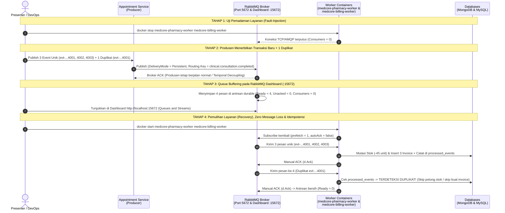

# Bagian 4: Simulasi Uji Gangguan & Resiliensi (Chaos Simulation)
**Durasi Presentasi**: Menit `15:00 – 22:00` (7 Menit)

Dokumen ini berisi panduan langkah demi langkah untuk menjalankan **Chaos Simulation (Fault-Injection, Queue Buffering / Temporal Decoupling, Zero Message Loss, & Idempotency)** pada arsitektur *Event-Driven* MedCore menggunakan RabbitMQ dan Docker.

---

## 1. Arsitektur & Skenario Chaos Simulation



---

## 2. Cara Cepat: Menjalankan Skrip Simulasi Interaktif

Kami telah menyiapkan skrip simulasi otomatis/interaktif di [`medcore-workspace/scripts/chaos_simulation.sh`](../scripts/chaos_simulation.sh) yang akan memandu setiap tahapan dengan jeda `[ENTER]` agar Anda dapat menampilkan **RabbitMQ Management Dashboard (`http://localhost:15672`)** saat rekaman/demo:

```bash
cd medcore-workspace

# 1. Pastikan seluruh kontainer DB, Message Broker, dan Worker berjalan
docker compose -f docker-compose.db.yml up -d --build

# 2. Jalankan simulasi interaktif (dengan jeda ENTER di tiap tahap)
./scripts/chaos_simulation.sh
```

> **Tips**:
> - Untuk menjalankan tanpa jeda interaktif (otomatis penuh): `./scripts/chaos_simulation.sh --auto`
> - Untuk mematikan satu kontainer spesifik saja (misal hanya Pharmacy atau hanya Billing):
>   - `./scripts/chaos_simulation.sh medcore-pharmacy-worker`
>   - `./scripts/chaos_simulation.sh medcore-billing-worker`

---

## 3. Panduan Perintah Manual (Langkah demi Langkah untuk Demo `15:00 – 22:00`)

Jika Anda ingin mengetikkan perintah secara manual di terminal selama presentasi, ikuti urutan di bawah ini dari direktori `medcore-workspace/`:

### Pra-Kondisi: Cek Status Kontainer & Stok Awal (Menit `15:00 – 16:00`)
Pastikan topologi RabbitMQ sudah aktif dan periksa stok awal obat `MED-AMX-500` (500 unit) serta tabel `processed_events`:

```bash
cd medcore-workspace
sh ./scripts/setup_rabbitmq_topology.sh
sh ./scripts/migrate_billing.sh

# Cek kontainer yang sedang berjalan
docker ps --format "table {{.Names}}\t{{.Status}}\t{{.Ports}}"

# Cek stok awal MED-AMX-500 di MongoDB (Pharmacy DB)
docker exec -i medcore-pharmacy-db mongosh --quiet \
  -u adm_pharmacy_svc -p 'SecuredPassPharm2026!' \
  --authenticationDatabase admin medcore_pharmacy_db \
  --eval 'db.drugs.findOne({ drug_code: "MED-AMX-500" }, { _id: 0, drug_code: 1, total_stock: 1 })'
```

---

### Langkah 1: Uji Pemadaman Layanan / Fault-Injection (Menit `16:00 – 17:00`)
Matikan kontainer pekerja (*consumer*) menggunakan `docker stop`:

```bash
# Matikan kontainer pekerja Pharmacy dan/atau Billing
docker stop medcore-pharmacy-worker medcore-billing-worker

# Buktikan kontainer berstatus Exited
docker ps -a --filter "name=medcore-pharmacy-worker" --filter "name=medcore-billing-worker"
```

---

### Langkah 2: Terbitkan Beberapa Transaksi Baru (+ Duplikat) dari Produsen (Menit `17:00 – 18:30`)
Dari sisi produsen (`appointment-service`), terbitkan **3 transaksi konsultasi baru** ditambah **1 transaksi duplikat** (mengulang `EVENT_ID` pertama untuk menguji idempotensi saat pemulihan):

```bash
cd services/appointment-service

# Transaksi 1 (Unik - memotong 15 stok MED-AMX-500 & membuat tagihan Rp150.000)
EVENT_ID="evt-44444444-4444-4444-8444-444444444001" go run main.go

# Transaksi 2 (Unik - memotong 15 stok MED-AMX-500 & membuat tagihan Rp150.000)
EVENT_ID="evt-44444444-4444-4444-8444-444444444002" go run main.go

# Transaksi 3 (Unik - memotong 15 stok MED-AMX-500 & membuat tagihan Rp150.000)
EVENT_ID="evt-44444444-4444-4444-8444-444444444003" go run main.go

# Transaksi 4 (DUPLIKAT dari Transaksi 1 untuk membuktikan Idempotency Guard)
EVENT_ID="evt-44444444-4444-4444-8444-444444444001" go run main.go

cd ../..
```
> **Poin Penjelasan Presentasi**: Perhatikan bahwa `appointment-service` berhasil menerbitkan keempat pesan tanpa mengalami *timeout* atau *error* meskipun `medcore-pharmacy-worker` dan `medcore-billing-worker` sedang mati. Ini membuktikan **Temporal Decoupling** antara produsen dan konsumen.

---

### Langkah 3: Tunjukkan Queue Buffering pada RabbitMQ Dashboard Port 15672 (Menit `18:30 – 20:00`)

1. Buka peramban (browser) ke alamat: **`http://localhost:15672`**
2. Masuk menggunakan kredensial dari `.env`:
   - **Username**: `admin_medcore`
   - **Password**: `SecuredPassRabbit2026!`
3. Klik tab **Queues and Streams** (pastikan Virtual Host **`medcore_vhost`** terpilih):
   - Tunjukkan antrean **`pharmacy.prescription.order.q`** dan **`billing.invoice.q`**:
     - **Features**: `D` (*Durable*) dan `DLX` (*Dead-Letter Exchange*)
     - **Ready**: **`4`** (4 pesan tertahan aman di dalam antrean / *queue buffering*)
     - **Unacked**: **`0`**
     - **Total**: **`4`**
     - **Consumers**: **`0`** (tidak ada konsumen aktif karena kontainer sedang di-*stop*)
   - Bandingkan dengan **`notification.patient.alert.q`** (jika `medcore-notification-worker` tetap menyala): `Ready = 0` karena langsung dikonsumsi oleh worker notifikasi.
4. Anda juga dapat menampilkannya lewat terminal:
   ```bash
   docker exec -i medcore-message-broker rabbitmqadmin \
     -u admin_medcore -p 'SecuredPassRabbit2026!' -V medcore_vhost \
     list queues name messages_ready messages_unacknowledged messages consumers
   ```

---

### Langkah 4: Nyalakan Kembali Kontainer Pekerja, Buktikan Zero Message Loss & Idempotensi (Menit `20:00 – 22:00`)

1. **Nyalakan kembali kontainer pekerja**:
   ```bash
   docker start medcore-pharmacy-worker medcore-billing-worker
   ```

2. **Tunjukkan perubahan pada RabbitMQ Dashboard (`http://localhost:15672`) & CLI**:
   - Kolom **Consumers** langsung berubah menjadi **`1`**.
   - Kolom **Ready** dan **Total** pada `pharmacy.prescription.order.q` serta `billing.invoice.q` langsung turun dari **`4` menjadi `0`** (*Zero Message Loss*).

3. **Tunjukkan Log Kontainer Pekerja (Bukti Deduplication / Idempotency Guard)**:
   ```bash
   docker logs --tail 30 medcore-pharmacy-worker
   docker logs --tail 20 medcore-billing-worker
   ```
   - Pada log `medcore-pharmacy-worker`, terlihat:
     - 3 pesan unik (`...4001`, `...4002`, `...4003`) diproses dan memotong stok masing-masing 15 unit.
     - Pesan ke-4 (`...4001`) memicu:
       `[Deduplication Guard] Event evt-44444444-4444-4444-8444-444444444001 terdeteksi duplikat! Melewati eksekusi bisnis dan langsung mengirim ACK.`
   - Pada log `medcore-billing-worker`, terlihat:
     - `billing acknowledged event=evt-44444444-4444-4444-8444-444444444001 ... duplicate=false`
     - `billing acknowledged event=evt-44444444-4444-4444-8444-444444444002 ... duplicate=false`
     - `billing acknowledged event=evt-44444444-4444-4444-8444-444444444003 ... duplicate=false`
     - `billing acknowledged event=evt-44444444-4444-4444-8444-444444444001 ... duplicate=true`

4. **Buktikan Konsistensi Data di Basis Data (Zero Message Loss + Idempotent)**:
   - **Verifikasi MongoDB (`medcore-pharmacy-db`)**:
     ```bash
     docker exec -i medcore-pharmacy-db mongosh --quiet \
       -u adm_pharmacy_svc -p 'SecuredPassPharm2026!' \
       --authenticationDatabase admin medcore_pharmacy_db \
       --eval '
         print("=== STOK AKHIR MED-AMX-500 (500 - 3x15 = 455) ===");
         printjson(db.drugs.findOne({ drug_code: "MED-AMX-500" }, { _id: 0, drug_code: 1, total_stock: 1 }));
         print("=== KOLEKSI processed_events (Tepat 3 Dokumen Unik) ===");
         db.processed_events.find({ event_id: /^evt-44444444/ }, { _id: 0 }).forEach(d => printjson(d));
       '
     ```
     *Hasil*: `total_stock` menjadi **`455`** (berkurang $3 \times 15 = 45$, **bukan** $4 \times 15 = 60$), dan hanya ada **3** dokumen di `processed_events`.

   - **Verifikasi MySQL (`medcore-billing-db`)**:
     ```bash
     docker exec -i medcore-billing-db sh -c \
       'MYSQL_PWD="$MYSQL_PASSWORD" mysql --protocol=tcp -h 127.0.0.1 -u "$MYSQL_USER" "$MYSQL_DATABASE" -t -e "
         SELECT pe.event_id, pe.invoice_id, i.total_amount, i.payment_status, pe.processed_at
         FROM processed_events pe
         JOIN invoices i ON i.invoice_id = pe.invoice_id
         WHERE pe.event_id LIKE '\''evt-44444444%'\''
         ORDER BY pe.event_id;
       "'
     ```
     *Hasil*: Hanya ada tepat **3 baris invoice** yang terbentuk (tidak ada tagihan ganda untuk `evt-44444444-4444-4444-8444-444444444001`).
