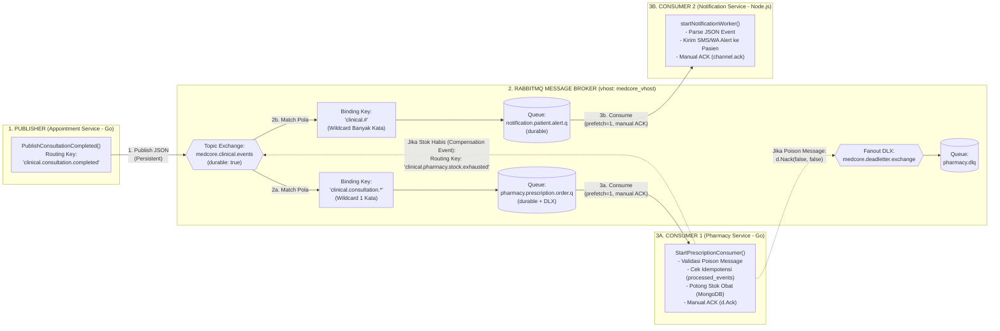

# Rangkuman Alur Event-Driven RabbitMQ: Appointment Publisher $\rightarrow$ Pharmacy Consumer & Notification Consumer

Dokumen ini merangkum alur arsitektur komunikasi asinkron menggunakan **RabbitMQ (AMQP 0-9-1)** mulai dari:
**`Publisher` $\rightarrow$ `Exchange (Topic)` $\rightarrow$ `Binding Key` $\rightarrow$ `Queue` $\rightarrow$ `Consumer`**, beserta potongan inti kode pada setiap tahapan.

---

## 1. Diagram Alur End-to-End (`Publisher` $\rightarrow$ `Exchange` $\rightarrow$ `Binding` $\rightarrow$ `Queue` $\rightarrow$ `Consumer`)



---

## 2. Bedah Alur & Inti Kode di Setiap Tahap

### Tahap 1: Publisher (`Appointment Service`) $\rightarrow$ Menuju `Topic Exchange`
**File**:
- `services/appointment-service/main.go`
- `services/appointment-service/publisher/event_publisher.go`

**Apa yang terjadi?**
1. Saat dokter menyelesaikan konsultasi, `Appointment Service` membuka koneksi ke RabbitMQ dan mendeklarasikan **Topic Exchange** bernama **`medcore.clinical.events`**.
2. `Appointment Service` menyusun struct `ConsultationCompletedEvent` (berisi `event_id`, `appointment_id`, `patient_id`, daftar obat di `prescription`, dan `billing_summary`).
3. Pesan dikirim ke **Exchange** (bukan langsung ke Queue) dengan membawa **Routing Key = `"clinical.consultation.completed"`** dan mode penyimpanan **`amqp.Persistent`** agar pesan tersimpan di disk jika consumer sedang mati.

#### Inti Kode yang Melekat pada Publisher:
```go
// 1. Deklarasi Topic Exchange (services/appointment-service/publisher/event_publisher.go)
err = ch.ExchangeDeclare(
    "medcore.clinical.events", // Nama Exchange
    "topic",                   // Tipe Topic (mendukung wildcard * dan #)
    true,                      // Durable (tahan restart broker)
    false, false, false, nil,
)

// 2. Menerbitkan Event ke Exchange dengan Routing Key
routingKey := "clinical.consultation.completed"
err = p.channel.PublishWithContext(
    ctx,
    "medcore.clinical.events", // Tujuan: Exchange (bukan Queue)
    routingKey,                // Alamat surat: "clinical.consultation.completed"
    true,                      // Mandatory
    false,
    amqp.Publishing{
        DeliveryMode: amqp.Persistent, // Pesan disimpan ke disk
        ContentType:  "application/json",
        MessageId:    event.EventID,
        Body:         body,            // Payload JSON
    },
)
```

---

### Tahap 2: `Exchange` $\rightarrow$ `Binding` $\rightarrow$ `Queue` $\rightarrow$ `Pharmacy Consumer`
**File**: `services/pharmacy-service/consumer/prescription_consumer.go`

**Apa yang terjadi?**
1. **Deklarasi Queue & Dead-Letter Exchange (DLX)**:
   `Pharmacy Service` membuat antrean durable bernama **`pharmacy.prescription.order.q`** yang dilengkapi argumen `x-dead-letter-exchange: "medcore.deadletter.exchange"` (agar pesan rusak/poison otomatis dibuang ke `pharmacy.dlq`).
2. **Binding ke Exchange dengan Wildcard `*`**:
   Queue diikat (*bind*) ke Exchange `medcore.clinical.events` menggunakan **Binding Key `"clinical.consultation.*"`**. Karena publisher mengirim `"clinical.consultation.completed"`, kata ke-3 (`completed`) cocok dengan `*`, sehingga RabbitMQ menyalin pesan ke dalam queue `pharmacy.prescription.order.q`.
3. **Konsumsi & Mutasi Database MongoDB (`handleDelivery`)**:
   - **QoS Prefetch = 1 & Manual ACK (`autoAck = false`)**: Mengambil 1 pesan dalam satu waktu dan tidak menghapus pesan dari queue sebelum diproses tuntas.
   - **Filter Poison Message**: Jika JSON rusak atau `quantity <= 0`, langsung ditolak ke DLQ dengan `d.Nack(false, false)` (`requeue = false`).
   - **Idempotency Guard**: Mengecek koleksi `processed_events` di MongoDB berdasarkan `event_id`. Jika sudah pernah diproses, langsung `d.Ack(false)` tanpa memotong stok dua kali.
   - **Mutasi Stok Obat**: Memotong `total_stock` obat di koleksi `drugs` menggunakan operasi atomik `$inc: -Quantity`.
   - **Compensation Event (Jika Stok Habis)**: Jika stok obat tidak cukup (`MatchedCount == 0`), Pharmacy me-*rollback* stok item sebelumnya dan menerbitkan event balasan `clinical.pharmacy.stock.exhausted` kembali ke Exchange `medcore.clinical.events`.
   - **Simpan Status & ACK**: Mencatat `event_id` dengan status `"SUCCESS"` ke koleksi `processed_events` lalu mengirim `d.Ack(false)`.

#### Inti Kode yang Melekat pada Pharmacy Consumer:
```go
// 1. Deklarasi Queue + Dead-Letter Exchange (DLX)
args := amqp.Table{"x-dead-letter-exchange": "medcore.deadletter.exchange"}
q, err := ch.QueueDeclare("pharmacy.prescription.order.q", true, false, false, false, args)

// 2. Binding Queue ke Exchange menggunakan Wildcard '*' (1 kata)
err = ch.QueueBind(
    q.Name,                    // Queue: "pharmacy.prescription.order.q"
    "clinical.consultation.*", // Binding Key (cocok dengan clinical.consultation.completed)
    "medcore.clinical.events", // Exchange sumber
    false, nil,
)

// 3. Set Prefetch=1 & Subscribe dengan Manual ACK (autoAck = false)
ch.Qos(1, 0, false)
msgs, err := ch.Consume(q.Name, "pharmacy-worker", false, false, false, false, nil)

// 4. Inti Pemrosesan Pesan (handleDelivery)
// a) Poison Message -> NACK tanpa requeue (masuk ke pharmacy.dlq)
if it.Quantity <= 0 {
    d.Nack(false, false)
    return
}

// b) Idempotency Check di MongoDB (koleksi processed_events)
err := events.FindOne(ctx, bson.M{"event_id": evt.EventID}).Err()
if err == nil {
    d.Ack(false) // Duplikat: lewati potong stok, langsung ACK
    return
}

// c) Mutasi Potong Stok di MongoDB (koleksi drugs)
res, err := drugs.UpdateOne(ctx,
    bson.M{"drug_code": it.DrugCode, "total_stock": bson.M{"$gte": it.Quantity}},
    bson.M{"$inc": bson.M{"total_stock": -it.Quantity}},
)

// d) Catat Status Transaksi & Kirim Manual ACK ke RabbitMQ
events.InsertOne(ctx, ProcessedEventRecord{EventID: evt.EventID, Status: "SUCCESS"})
d.Ack(false)
```

---

### Tahap 3: `Exchange` $\rightarrow$ `Binding` $\rightarrow$ `Queue` $\rightarrow$ `Notification Consumer`
**File**: `services/notification-service/src/notification_worker.js`

**Apa yang terjadi?**
1. **Deklarasi Queue**:
   `Notification Service` (Node.js) membuat antrean durable bernama **`notification.patient.alert.q`**.
2. **Binding ke Exchange dengan Wildcard `#`**:
   Queue diikat ke Exchange `medcore.clinical.events` menggunakan **Binding Key `"clinical.#"`**.
   - Karena memakai `#` (mencocokkan berapa pun kata setelah `clinical.`), antrean ini menerima:
     1. Event **`clinical.consultation.completed`** yang dikirim oleh **Appointment Publisher**, **DAN**
     2. Event kompensasi **`clinical.pharmacy.stock.exhausted`** yang dikirim oleh **Pharmacy Consumer** apabila stok obat habis!
3. **Konsumsi & Manual ACK**:
   Worker membaca isi JSON, mencetak pengiriman notifikasi SMS/WhatsApp ke `patient_id` terkait `appointment_id`, lalu mengirim **`channel.ack(msg)`** (`noAck: false`).

#### Inti Kode yang Melekat pada Notification Consumer:
```javascript
// 1. Deklarasi Exchange & Queue Durable (services/notification-service/src/notification_worker.js)
await channel.assertExchange('medcore.clinical.events', 'topic', { durable: true });
const q = await channel.assertQueue('notification.patient.alert.q', { durable: true });

// 2. Binding Queue ke Exchange menggunakan Wildcard '#' (semua event clinical.*)
await channel.bindQueue(q.queue, 'medcore.clinical.events', 'clinical.#');

// 3. Prefetch = 1 & Consume dengan Manual ACK (noAck: false)
await channel.prefetch(1);
channel.consume(
    q.queue,
    (msg) => {
        if (msg !== null) {
            const eventData = JSON.parse(msg.content.toString());

            console.log(
                `\n[SMS/WhatsApp Gateway] Mengirim Notifikasi ke Pasien: ${eventData.payload.patient_id}`
            );
            console.log(
                `Pesan: "Sesi konsultasi Anda (${eventData.payload.appointment_id}) telah selesai. Resep sedang disiapkan oleh Farmasi."`
            );

            // 4. Kirim Manual ACK setelah notifikasi berhasil diproses
            channel.ack(msg);
        }
    },
    { noAck: false }
);
```

---

## 3. Tabel Ringkasan Perbandingan Ketiga Komponen

| Aspek | 1. Appointment Service (Publisher) | 2. Pharmacy Service (Consumer 1) | 3. Notification Service (Consumer 2) |
| :--- | :--- | :--- | :--- |
| **Bahasa & File** | Go (`services/appointment-service/`) | Go (`services/pharmacy-service/`) | Node.js (`services/notification-service/`) |
| **Exchange** | `medcore.clinical.events` (`topic`) | `medcore.clinical.events` (`topic`) | `medcore.clinical.events` (`topic`) |
| **Routing / Binding Key** | **Routing Key**:<br/>`clinical.consultation.completed` | **Binding Key**:<br/>`clinical.consultation.*` | **Binding Key**:<br/>`clinical.#` |
| **Nama Queue** | *(Tidak punya Queue, kirim ke Exchange)* | `pharmacy.prescription.order.q` | `notification.patient.alert.q` |
| **Aksi / Mutasi Data** | Menerbitkan JSON event konsultasi selesai (`Persistent`) | Cek duplikat (`processed_events`), potong stok obat di MongoDB (`drugs`), atau terbitkan *Compensation Event* jika stok habis | Mengirim notifikasi SMS/WA ke pasien untuk setiap event klinis |
| **Mekanisme ACK / DLQ** | Mandatory publish | `autoAck: false`, `d.Ack(false)` / `d.Nack(false, false)` ke `pharmacy.dlq` | `noAck: false`, `channel.ack(msg)` |
